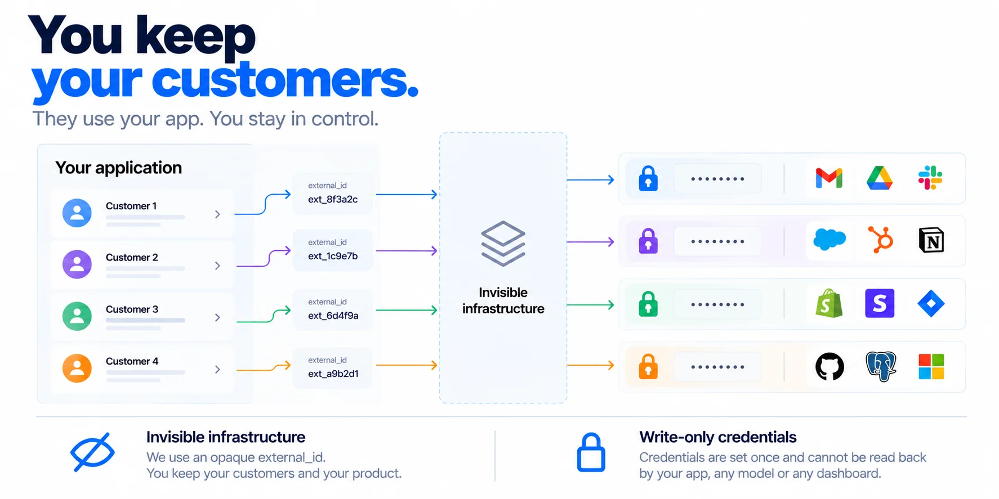

<div align="center">

# Vinkius Connect for Python

### Build AI agents that act for each user.

One SDK for user-specific tools, credentials, permissions, and execution across **11,000+ systems**.

[](https://vinkius.com)
[](https://vinkius.com)

[Documentation](https://vinkius.com/learn/en/connect-sdk) · [Vinkius Cloud](https://cloud.vinkius.com) · [Site](https://vinkius.com)

</div>

---


<br >

AI applications become more useful when they can take action in the systems their users already work with. But shipping those actions means dealing with integrations, OAuth, credential storage, permissions, API changes, and model-specific tool formats.

**Vinkius Connect handles that connectivity layer.** Your application keeps its users and customer experience. Vinkius resolves each user's connected systems and available capabilities, executes actions on their behalf, and returns the result.


```text
Your AI application
        │
        │  Your authenticated user's external_id
        ▼
Vinkius Connect
  identity · connections · credentials · capabilities · execution
        │
        ├── GitHub
        ├── Slack
        ├── Project management
        └── 11,000+ connected systems
```

## Why Vinkius Connect?

- **Built for multi-user AI products.** Each user has their own connections and available capabilities.
- **One consistent interface.** Discover and execute actions without implementing each integration yourself.
- **Credentials stay out of model context.** Connector secrets are write-only through the documented API and are not returned to application code.
- **Framework flexibility.** Adapt capabilities to OpenAI, Anthropic, Gemini, LangChain, LlamaIndex, OpenAI Agents, CrewAI, or a neutral JSON Schema format.
- **Managed connectivity.** Vinkius maintains connectors and their evolving APIs.
- **Your product stays yours.** Use your application's own user IDs and keep the customer relationship and user experience in your product.

## How it works

1. **Identify the user.** Pass the stable `external_id` assigned by your application backend.
2. **Discover capabilities.** Vinkius resolves the user's ready connectors and the actions they expose.
3. **Provide tools to the model.** Convert those capabilities into the tool format expected by your model or framework.
4. **Execute the selected action.** Send the tool call to Vinkius and return the result to your agent loop.

The `external_id` is an identifier, **not an authentication mechanism**. Only pass an ID that your backend has associated with the currently authenticated user. Never trust a user ID supplied directly by an untrusted client.



## Installation

Python **3.10+** is required. The SDK uses `httpx` as its runtime dependency.

### Install from PyPI

```bash
pip install vinkius-connect
```

If the package is not yet available on PyPI, install the current repository version:

```bash
pip install "git+https://github.com/VinkiusForDevs/ai-connect-sdk-python.git"
```

## Quick start

Create an AI application in [Vinkius Cloud](https://cloud.vinkius.com), then create an application key. Keep the key on your server. **Never expose it in browser code, mobile clients, or model prompts.**

Set the environment variables:

```bash
export VINKIUS_APP_ID="vk_app_..."
export VINKIUS_APP_KEY="vk_app_sk_..."
```

Then discover and execute a capability:

```python
import os
from vinkius_connect import Vinkius


async def main() -> None:
    async with Vinkius(
        app_id=os.environ["VINKIUS_APP_ID"],
        api_key=os.environ["VINKIUS_APP_KEY"],
    ) as vinkius:
        # Use the ID of the authenticated user from your own backend.
        user = vinkius.user("alice_123")

        # Discover actions available through this user's ready connectors.
        capabilities = await user.capabilities()

        # Execute one capability by its namespaced name.
        result = await capabilities.find_capability(
            "github__create_issue"
        ).execute(
            {
                "owner": "acme",
                "repo": "product",
                "title": "Ship it",
            }
        )

        print(result.text())


if __name__ == "__main__":
    import asyncio
    asyncio.run(main())
```

The capability name and input schema depend on the connector and capabilities available to that user. Discover available capabilities before attempting to execute one.

## Use capabilities with an AI model

The usual agent loop is straightforward:

1. Fetch the authenticated user's capabilities.
2. Convert them into the model's tool format.
3. Send the user's request and tools to the model.
4. Execute the returned tool call through Vinkius.
5. Return the result to the model as part of your agent loop.

### Example: OpenAI Chat Completions

Install the OpenAI client for this example:

```bash
pip install openai
```

```python
import os
import asyncio
import openai
from vinkius_connect import Vinkius
from vinkius_connect.adapters import openai as vk_openai


async def main() -> None:
    client = openai.AsyncOpenAI()

    async with Vinkius(
        app_id=os.environ["VINKIUS_APP_ID"],
        api_key=os.environ["VINKIUS_APP_KEY"],
    ) as vinkius:
        # Resolve this ID only after authenticating the user in your backend.
        caps = await vinkius.user("alice_123").capabilities()

        response = await client.chat.completions.create(
            model=os.environ["OPENAI_MODEL"],
            messages=[
                {
                    "role": "user",
                    "content": "Open a GitHub issue titled 'Ship it'",
                }
            ],
            tools=vk_openai.to_openai_tools(caps),
        )

        message = response.choices[0].message
        if not message.tool_calls:
            print(message.content or "No tool call returned.")
            return

        # Production agent loops should handle each tool call and send its result
        # back to the model using the provider's expected format.
        for tool_call in message.tool_calls:
            result = await vk_openai.run_openai_tool_call(caps, tool_call)
            print(result.text())


if __name__ == "__main__":
    asyncio.run(main())
```

For a fuller example, see [`examples/openai_end_to_end.py`](examples/openai_end_to_end.py) and [`examples/chatbot.py`](examples/chatbot.py).

## Connect a user's system

Provision a connector for a user, set its credentials, check its status, and inspect its capabilities:

```python
user = vinkius.user("alice_123")
github = user.connector("github")

await github.connect()  # Get or create the connection
await github.credentials.set({"GITHUB_TOKEN": token})

status = await github.status()
print(status)  # not_connected, needs_credentials, ready, or disabled

capabilities = await github.capabilities()
```

The example assumes `vinkius` is already configured and `token` was obtained securely. In a production application, prefer the supported authorization flow for the connector where available, and never ask users to paste secrets into an AI conversation.

Credential values are write-only through the documented interface. The credential schema and whether a value is set can be inspected; secret values cannot be read back.

## Framework adapters

A capability set can be converted to different tool formats. Adapter modules shape the tools; they do not require the target framework merely to perform the conversion. Install the relevant framework if your application or tests need it.

| Framework / format | Adapter module | Main functions |
| --- | --- | --- |
| OpenAI Chat Completions | `adapters.openai` | `to_openai_tools`, `run_openai_tool_call` |
| Anthropic Messages | `adapters.anthropic` | `to_anthropic_tools`, `run_anthropic_tool_use` |
| Google Gemini | `adapters.gemini` | `to_gemini_tools`, `run_gemini_function_call` |
| LangChain | `adapters.langchain` | `to_langchain_tools` |
| LlamaIndex | `adapters.llamaindex` | `to_llamaindex_tools` |
| OpenAI Agents | `adapters.openai_agents` | `to_openai_agents_tools` |
| CrewAI | `adapters.crewai` | `to_crewai_tools`, `execute_capability_sync` |
| Framework-neutral | `adapters.json_schema` | `to_json_schema_tools`, `execute_by_name` |

Example:

```python
from vinkius_connect.adapters import openai, anthropic, gemini, json_schema

caps = await vinkius.user("alice_123").capabilities()

openai_tools = openai.to_openai_tools(caps)
anthropic_tools = anthropic.to_anthropic_tools(caps)
gemini_tools = gemini.to_gemini_tools(caps)
json_schema_tools = json_schema.to_json_schema_tools(caps)
```

## Core concepts

| Concept | Meaning |
| --- | --- |
| **Connector** | An external system a user connects, such as GitHub or Slack. |
| **Capability** | An executable action exposed by a connector, such as listing repositories or creating an issue. |
| **User** | A user identified by your application's `external_id`. Vinkius does not require a separate end-user identity. |
| **Control plane** | Provisioning and state management for users, connectors, credentials, and catalog discovery. |
| **Execution plane** | Runtime capability discovery and execution, per user through a short-lived token. |

### Capability discovery behavior

`user.capabilities()` resolves the user's ready connectors in parallel, with concurrency capped at eight. A single unresponsive connector does not necessarily fail the whole batch. Use `on_connector_error` to observe individual connector failures. If all connectors fail, the first error is raised.

## Configuration

```python
from vinkius_connect import Vinkius

vinkius = Vinkius(
    app_id="vk_app_...",
    api_key="vk_app_sk_...",
    timeout_ms=30_000,  # default
    max_retries=2,      # default; retry-safe requests only
    client=None,        # optionally inject an httpx.AsyncClient
    user_agent="acme-ai/1.0",
    namespace_capability=lambda connector, name: f"{connector}__{name}",
    hooks=None,
)
```

- **`app_id`** identifies your Vinkius application.
- **`api_key`** is a server-side secret. Keep it out of clients and prompts.
- **`timeout_ms`** sets the request timeout.
- **`max_retries`** controls retries for retry-safe requests.
- **`client`** lets you inject an `httpx.AsyncClient`, useful for tests and custom transports.
- **`user_agent`** appends your application's identifier to the SDK user agent.
- **`namespace_capability`** controls how connector and capability names are combined.
- **`hooks`** configures observability hooks; sensitive headers and bodies are redacted before hooks run.

Use `await vinkius.aclose()` to release the SDK's HTTP client, or use `async with Vinkius(...)` as shown above.

### Retries and idempotency

Transient HTTP statuses (`429`, `502`, `503`, `504`) and network errors are retried with full-jitter backoff only for retry-safe requests. Idempotent methods and requests carrying an `idempotency_key` may be retried. Non-idempotent POST requests, such as minting a connection token, are not automatically retried.

For actions that create or modify data in external systems, design your agent loop to account for duplicate requests and uncertain outcomes. Use idempotency support where available and appropriate.

## Low-level API

The fluent API has REST equivalents when you need more direct control:

```python
connection = await vinkius.users.connections("alice_123").create(
    {"connector": "github"}
)

await vinkius.users.connections("alice_123").credentials(connection["id"]).set(
    {"credentials": {"GITHUB_TOKEN": "..."}}
)

await vinkius.catalog.search("github")

async for connector in vinkius.catalog.iterate():
    print(connector)
```

## Error handling

SDK exceptions inherit from `VinkiusError` and expose a status, stable error code, and server `request_id` where available.

Common exception types include:

- `ConfigError`
- `AuthError`
- `NotFoundError`
- `ValidationError`
- `RateLimitError`
- `QuotaError`
- `OverageError`
- `ConnectorNotConnectedError`
- `ConnectionError`
- `ProtocolError`

```python
from vinkius_connect import VinkiusError, RateLimitError

try:
    caps = await vinkius.user("alice_123").capabilities()
except RateLimitError as exc:
    # Inspect retry_after_ms when present.
    print(exc.retry_after_ms)
except VinkiusError as exc:
    # Useful for logs and support; avoid logging secrets or sensitive payloads.
    print(exc.code, exc.status, exc.request_id)
```

Capability-level execution failures are returned as results with `is_error` set, allowing an agent loop to pass the failure back to the model and recover. Transport, configuration, and protocol failures are raised as exceptions.

## Security practices

- **Keep application keys server-side.** Never ship `vk_app_sk_*` in frontend code, mobile applications, repositories, or prompts.
- **Authenticate users in your application.** Resolve `external_id` from trusted backend state; do not accept arbitrary user IDs from clients.
- **Scope actions to the right user.** Fetch and execute capabilities for the authenticated user's identity only.
- **Keep raw secrets out of prompts.** Connector credentials are write-only through the documented API and are not intended for model context.
- **Treat tool calls as actions.** Apply your product's confirmation, authorization, and policy requirements before executing sensitive or irreversible operations.
- **Protect logs.** Do not log API keys, tokens, credential values, or sensitive customer data.
- **Handle revocation and failures.** Make connection state visible in your product and define how your application responds when a connector is disabled, expired, or unavailable.

Vinkius Connect provides connectivity and execution primitives. Your application remains responsible for authenticating its users, enforcing product-level policy, and deciding when an AI-requested action requires confirmation.

## Development

Clone the repository and install the test dependencies:

```bash
pip install -e ".[test]"
pytest
```

The SDK's tests use an injectable fake transport and can run offline. Framework-specific extras can be installed for examples and tests that construct real framework objects, for example:

```bash
pip install -e ".[openai,anthropic,langchain]"
```

## License

[Apache License 2.0](./LICENSE), Copyright Vinkius.
